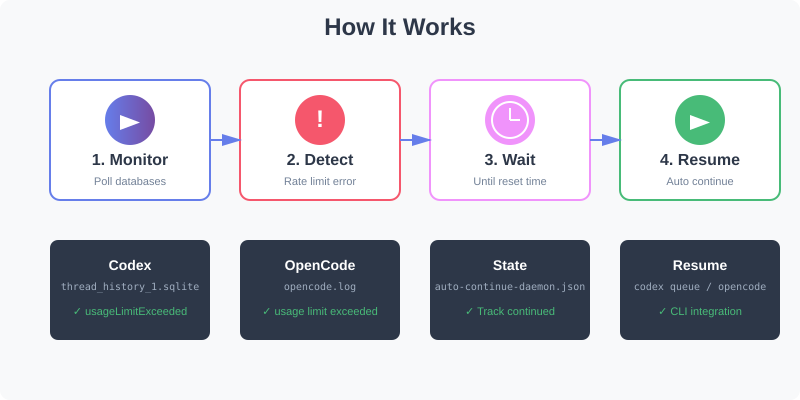

# Auto-Continue Daemon

<p align="center">
  
</p>

<p align="center">
  <strong>Never let rate limits stop your AI coding flow</strong>
</p>

<p align="center">
  
  
  
  
</p>

---

## 🚀 Overview

**Auto-Continue** is a background daemon that automatically continues your AI coding sessions when you hit rate limits. It monitors [Codex CLI](https://github.com/openai/codex) and [OpenCode](https://github.com/opencode-ai/opencode), detects rate limit errors, waits for the reset time, and seamlessly resumes your sessions.

**No more manual intervention. No more lost context. Just continuous productivity.**

## ✨ Features

<table>
<tr>
<td width="50%">

### 🤖 Multi-Tool Support
- **Codex CLI** (OpenAI) — monitors SQLite database
- **OpenCode** — monitors log files
- Unified daemon for both tools

</td>
<td width="50%">

### ⚡ Smart Detection
- Polls every 30 seconds
- Detects `usageLimitExceeded` errors
- Extracts reset times from error messages
- 2-hour max wait cap (prevents stale errors)

</td>
</tr>
<tr>
<td width="50%">

### 🔄 Automatic Resume
- Codex: `codex queue --resume`
- OpenCode: `opencode --continue`
- Preserves full session context

</td>
<td width="50%">

### 🛡️ Production Ready
- Systemd service integration
- State tracking (no duplicate actions)
- Configurable polling intervals
- Comprehensive logging

</td>
</tr>
</table>

## 📊 How It Works

<p align="center">
  
</p>

1. **Monitor** — Daemon polls tool databases/logs every 30 seconds
2. **Detect** — Identifies rate limit errors from the last 5 minutes
3. **Wait** — Extracts reset time and sleeps until then (max 2h)
4. **Resume** — Automatically continues the session via CLI

## 📦 Installation

### Prerequisites
- Python 3.7+ (stdlib only, **zero dependencies**)
- Codex CLI and/or OpenCode installed
- systemd (for service mode)

### Quick Start

```bash
# Clone the repository
git clone https://github.com/wmaciejak/auto-continue-agent.git
cd auto-continue-agent

# Make daemon executable
chmod +x daemon.py

# Install systemd service
cp auto-continue-daemon.service ~/.config/systemd/user/
systemctl --user daemon-reload
systemctl --user enable auto-continue-daemon.service
systemctl --user start auto-continue-daemon.service

# Check status
systemctl --user status auto-continue-daemon.service
```

## 🎯 Usage

### Run in Foreground

```bash
# Default settings (poll every 30s, INFO logging)
./daemon.py

# Custom poll interval
./daemon.py --poll-interval 60

# Debug mode
./daemon.py --log-level DEBUG
```

### Run as Background Service

```bash
# Start the daemon
systemctl --user start auto-continue-daemon.service

# View logs in real-time
journalctl --user -u auto-continue-daemon.service -f

# Check service status
systemctl --user status auto-continue-daemon.service

# Stop the daemon
systemctl --user stop auto-continue-daemon.service

# Disable autostart
systemctl --user disable auto-continue-daemon.service
```

## ⚙️ Configuration

Edit constants at the top of `daemon.py`:

```python
# Polling interval (seconds)
DEFAULT_POLL_INTERVAL = 30

# Default wait time when reset time not in error (minutes)
DEFAULT_WAIT_MINUTES = 60

# Safety limit to prevent infinite loops
MAX_CONSECUTIVE_WAITS = 10

# Absolute maximum wait time (seconds)
MAX_WAIT_SECONDS = 7200  # 2 hours
```

### State File

The daemon tracks continued sessions in `~/.local/state/auto-continue-daemon.json`:

```json
{
  "continued_sessions": {
    "codex:01a1bb89-...": {
      "tool": "codex",
      "session_id": "01a1bb89-...",
      "turn_id": "01a1bb90-...",
      "continued_at": "2026-11-09T21:30:00",
      "wait_seconds": 3600
    }
  }
}
```

## 📝 Example Log Output

```
2026-11-09 21:30:37 [INFO] Starting auto-continue daemon (poll every 30s)
2026-11-09 21:30:37 [INFO] Monitoring Codex: /home/dev/.codex/thread_history_1.sqlite
2026-11-09 21:30:37 [INFO] Monitoring OpenCode: /home/dev/.local/share/opencode/log/opencode.log
2026-11-09 21:35:15 [INFO] Codex: rate limit detected in session 'Fix tests' (01a1bb89...)
2026-11-09 21:35:15 [INFO] Reset time: 7:54 PM (19:54:00). Waiting 3600s (60m0s)
2026-11-09 21:35:15 [INFO] Sleeping for 3600s...
2026-11-09 22:35:15 [INFO] Codex: queueing continue for thread 01a1bb89...
2026-11-09 22:35:16 [INFO] Codex: successfully queued continue message
2026-11-09 22:35:16 [INFO] Codex: auto-continue completed for session 'Fix tests'
```

## 🔧 Supported Tools

<div align="center">
<table>
<tr>
<td align="center">
  
  <br/>
  <strong>Codex CLI</strong>
  <br/>
  <small>OpenAI's coding agent</small>
  <br/>
  <code>thread_history_1.sqlite</code>
  <br/>
  <code>usageLimitExceeded</code>
</td>
<td align="center">
  
  <br/>
  <strong>OpenCode</strong>
  <br/>
  <small>AI coding assistant</small>
  <br/>
  <code>opencode.log</code>
  <br/>
  <code>usage limit exceeded</code>
</td>
</tr>
</table>
</div>

## 🐛 Troubleshooting

### Daemon not detecting errors

```bash
# Check data sources exist
ls -lh ~/.codex/thread_history_1.sqlite
ls -lh ~/.local/share/opencode/log/opencode.log

# Run with debug logging
./daemon.py --log-level DEBUG
```

### Codex queue command failing

```bash
# Verify codex is in PATH
which codex

# Check thread exists
sqlite3 ~/.codex/state_5.sqlite "SELECT id, name FROM threads WHERE id='<thread-id>';"
```

### OpenCode resume failing

```bash
# Verify opencode is in PATH
which opencode

# Check session exists
sqlite3 ~/.local/share/opencode/opencode.db "SELECT id, title FROM session_v2 WHERE id='<session-id>';"
```

### Reset to clean state

```bash
# Clear state file
rm ~/.local/state/auto-continue-daemon.json

# Restart daemon
systemctl --user restart auto-continue-daemon.service
```

## 📄 License

This project is licensed under the MIT License - see the [LICENSE](LICENSE) file for details.

## 🙏 Acknowledgments

- [Codex CLI](https://github.com/openai/codex) — OpenAI's coding agent
- [OpenCode](https://github.com/opencode-ai/opencode) — AI coding assistant
- Python standard library — zero dependencies FTW!

## 📮 Contact

- **Author**: Wojciech Maciejak
- **GitHub**: [@wmaciejak](https://github.com/wmaciejak)
- **Repository**: [auto-continue-agent](https://github.com/wmaciejak/auto-continue-agent)

---

<p align="center">
  <strong>Made with ❤️ for uninterrupted AI coding sessions</strong>
</p>

<p align="center">
  <sub>If this project helps you stay productive, consider giving it a ⭐ on GitHub!</sub>
</p>
